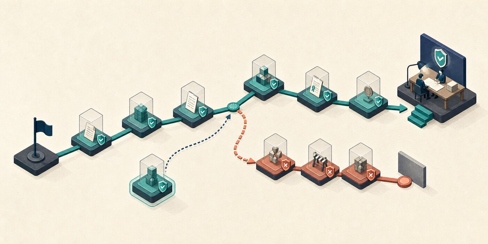

# Run Durable Work



Long work needs explicit state, not a longer prompt. `patpat-run` models phases and evidence as a deterministic local graph that can stop, resume, and reject stale proof.

## Use a graph when continuity matters

Choose a durable run when the task spans sessions, has dependent phases, needs checkpoints, or may be handed to another agent. Keep a bounded task in the normal loop; state machinery is overhead when one verified patch will finish the job.

## Define the finish condition

A duration is not a finish condition. State an observable predicate:

```text
/patpat keep working until every migration fixture passes against a clean database and the rollback restores the original schema. Pause safely on the third identical blocker.
```

The run can check that condition after each phase. It must not relax the condition to manufacture completion.

## Advance only with current evidence

The graph refuses:

- implementation without a proof contract;
- review without current content-bound evidence;
- completion without independent review;
- endless retries after the same blocker repeats three times.

Each checkpoint records enough state for a cold-start takeover to inspect the repository and continue from reality.

## Pause without pretending to finish

Use the safe-pause playbook when authority, environment access, or user input is genuinely required. Preserve the branch, graph state, current evidence, blocker, and next executable action. Do not open a pull request merely to make a pause look complete.

## Validate multi-PR plans

Before multi-PR execution, validate the checked plan:

```bash
python3 skills/patpat-run/scripts/validate_plan.py --self-test
```

Plan validity checks dependency, declared ownership, evidence, and review structure. It does not prove that a worker's eventual diff stays within its declared files; the integration owner must inspect changed paths before accepting each head. A valid plan never grants commit, merge, deploy, or publication authority.

For a validated multi-unit plan, `skills/patpat-run/scripts/program_state.py` persists the dependency frontier, worker inbox, exact-head verification ledger, assignment generations, and explicit dispatch and delivery gates under Git metadata. It does not spawn agents or call a provider. Assign only dependency-ready frontier units and keep active assignments within the `team_shape.py` worker limit; the state store does not enforce that cap. Every worker mutation carries the current assignment generation; reassignment increments the token and rejects late output from the old assignment. Head updates compare the caller's expected current head, and each dependent head must contain every declared dependency head in its Git ancestry. The store validates declared ownership overlap, not actual changed paths; the integration owner checks the diff against each unit's files before recording its head. Verdict slots are write-once per head and assignment. Closing dispatch revokes active assignments, so reopening requires fresh assignment calls. Unit inbox events require the current head; program-wide events and acknowledgement require the bound integration owner. These are coordination fences with self-asserted local identities, not worker authentication or an external process lease. Any unit head change clears that unit's prior proof and inbox; an upstream head change also revokes downstream assignments and evidence before the frontier can advance. Patpat rechecks ancestry at verdict, completion, and delivery boundaries. Unordered units cannot claim exact, ancestor, or conservatively overlapping declared ownership.

Schema-v1 stores require explicit `migrate-v1 --invalidate-legacy-evidence`. Migration preserves the plan and recorded heads but clears legacy verdicts and inbox events, closes both gates, and requires fresh assignments. Patpat never treats an old actor label as trusted identity. Schema-v2 stores require `migrate-v2 --invalidate-legacy-evidence`; migration preserves the plan and recorded heads, clears every unit's verification and review evidence plus the old dispatch binding and inbox, resets units to pending, revokes assignments, and closes both gates. Assignment generations advance where an assignment was active. Fresh schema-v2 evidence and unit proof are required before delivery.

Before applying either migration to an existing store, stop all writers and make a protected copy of the exact `state.json` outside the live store. Verify the copy by parsing it and recording its SHA-256, then get explicit user authorization naming the store and migration. Afterward, run `status --brief` and confirm the migrated schema and closed gates. If the result is semantically wrong, stop writers and restore the verified copy together with the pre-migration Patpat version that can read that schema; current code deliberately refuses schema-v2 state. Atomic replacement prevents a partial JSON write; it does not restore data after a successful migration.

Keep dispatch closed until the integration owner supplies one bounded schema-v2 parallel-gate receipt. Bind it to the program id, validated plan digest, integration owner, every unit's unique isolation identity, all earned-parallelism checks, and supporting evidence for each check. Each evidence entry is a bounded `{path, sha256, size}` binding created with `team_shape.py --bind-evidence /absolute/path/to/safe-artifact`. Use the same receipt for team selection and `set-gate dispatch open`. The engine checks that referenced files are present and unchanged when opening dispatch and before assignments, worker mutations, and delivery readiness; status reports evidence freshness. This makes the coordinator's basis inspectable, but does not prove the claims or host-enforced isolation. Substantiate the checks from the actual worktree, verifier, and resource boundaries, and keep writable work serial when they cannot be confirmed. A schema-v1 receipt causes serial fallback for writable selection and cannot open writable dispatch; read-only selection remains eligible under its own checks.

State mutations return bounded receipts by default so long ledgers do not flood agent context. Plan, state, receipt, and inbox inputs are bounded and reject linked files where they cross a trust boundary. Use `status --brief`, `status --unit <id>`, and bounded inbox pages for normal coordination; request full state only for a deliberate audit. Lock acquisition has a bounded timeout. Inspect abandoned locks before recovery. Only a dead same-host owner is recoverable automatically.

`delivery_admitted` remains a compatibility field for evidence plus gate state; it never means delivery authority. Check `delivery_authority_granted`, which is always false, and reacquire current delivery authority through `patpat-ship`.

Next: [Earn parallelism](./07-earned-parallelism.md).
